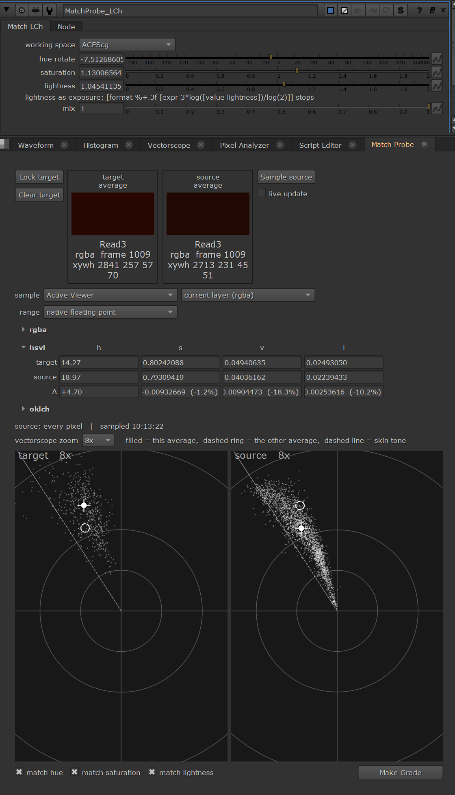

# Match Probe for Nuke



A Pixel-Analyzer-style panel for **comparing two image regions**. Lock one area as the **target**, sample another area as the **source**, and read exactly how far apart they are in RGB, HSV and perceptual (OKLab) terms. Then insert a node that matches them.

Useful for matching CG to plate, shot-to-shot continuity, patches and cleanups, and checking a grade.

Tested with Nuke / NukeX **14.1** and **17.0** on Windows. It's pure Python plus PySide2/PySide6, with no compiled plugins.

## Features

- **Target / source average swatches**, drawn through your viewer's own OCIO display transform (e.g. `sRGB (ACES)`), like the Pixel Analyzer's.
- **Sampling** follows the Pixel Analyzer: Ctrl+Shift+drag a region in the Viewer, from the *Active Viewer* or a named one, on the *current layer* or any other layer.
- **Value rows**, each showing target / source / Δ (absolute and %). Every section can be folded away with its disclosure triangle.
  - **rgba**: working-space values. Range is native floating point, or 8/10/16-bit.
  - **hsvl**: identical to Nuke's Pixel Analyzer. HSV hue in degrees, `s = (max-min)/max`, `v = max`, `l = 0.2125 R + 0.7154 G + 0.0721 B`.
  - **oklch**: perceptual lightness, chroma, hue and saturation (OKLab, chroma / lightness).
- **Two vectorscopes** (Rec.709 Cb/Cr, through the viewer transform). Each shows a dot cloud of its region's pixels, its own average as a crosshair, the other region's average as a dashed ring, a skin-tone line and auto zoom.
- **Make Grade** with **match hue / match saturation / match lightness** tick boxes. It inserts a `MatchProbe_LCh` node after the source:
  - It works in OKLab: hue rotate, saturation ×, and lightness × (an exposure change).
  - It has a mask input and mix.
  - With all three ticked, the source average lands exactly on the target. Each tick changes only its own component.
  - It's made of native nodes only, so it renders anywhere, even without Match Probe installed.
- The locked target is **saved with the script**.

## Install

1. Copy `matchProbe.py` and `colorMath.py` into a folder on your Nuke plugin path, e.g. `~/.nuke/python/`, with `nuke.pluginAddPath("python")` in `~/.nuke/init.py`.
2. Add to `~/.nuke/menu.py`:

```python
try:
    import matchProbe
    matchProbe.register()   # Window > Custom > Match Probe (dockable)
    nuke.menu('Nuke').addCommand('Scripts/Match Probe', 'matchProbe.show()')
except Exception as _err:
    nuke.tprint('matchProbe failed to load: %s' % _err)
```

3. Restart Nuke and open **Scripts > Match Probe**, or dock it from **Window > Custom > Match Probe**.

## Use

1. View a node and **Ctrl+Shift+drag** the target area, then press **Lock target**.
2. Ctrl+Shift+drag the source area, wait until the **Viewer has finished rendering**, then press **Sample source**. The source turns grey and says *stale* when the box, node or frame changes.
3. Read the Δ rows and the vectorscopes. Tick hue / saturation / lightness and press **Make Grade** to match.

### Why sampling is manual

Match Probe reads pixels with `nuke.sample()`. If that runs while the Viewer is still rendering the **same** nodes, Nuke can crash. This was seen with `Defocus` on the render threads. Nuke's Python API has no way to ask whether the Viewer has finished, so by default Match Probe never samples on its own.

The optional **live update** tick box re-samples automatically after 2 s without changes. It is off on every start and **can crash Nuke** on slow node trees.

Diagnostics, written to `~/.nuke/`:
- `matchprobe_trace.log`: what Match Probe was doing.
- `matchprobe_crash.log`: Python stacks if Nuke crashes.

## Tests

The tests run headless and need an interactive licence (`-i`):

```
Nuke --nukex -i -t tests/test_matchprobe.py <folder containing matchProbe.py>
```

## Credits

OKLab by Björn Ottosson. The constant tables were generated with [colour-science](https://www.colour-science.org/) 0.4.7.

## License

MIT, see [LICENSE](LICENSE).
